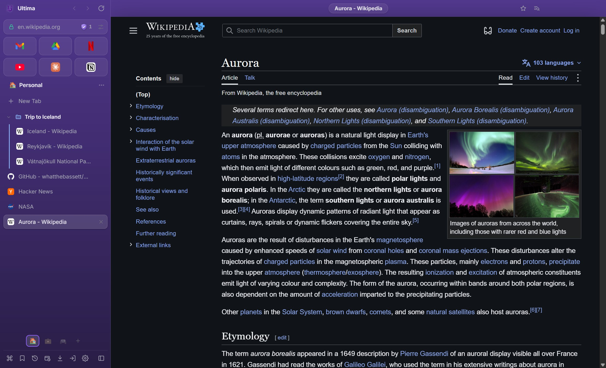
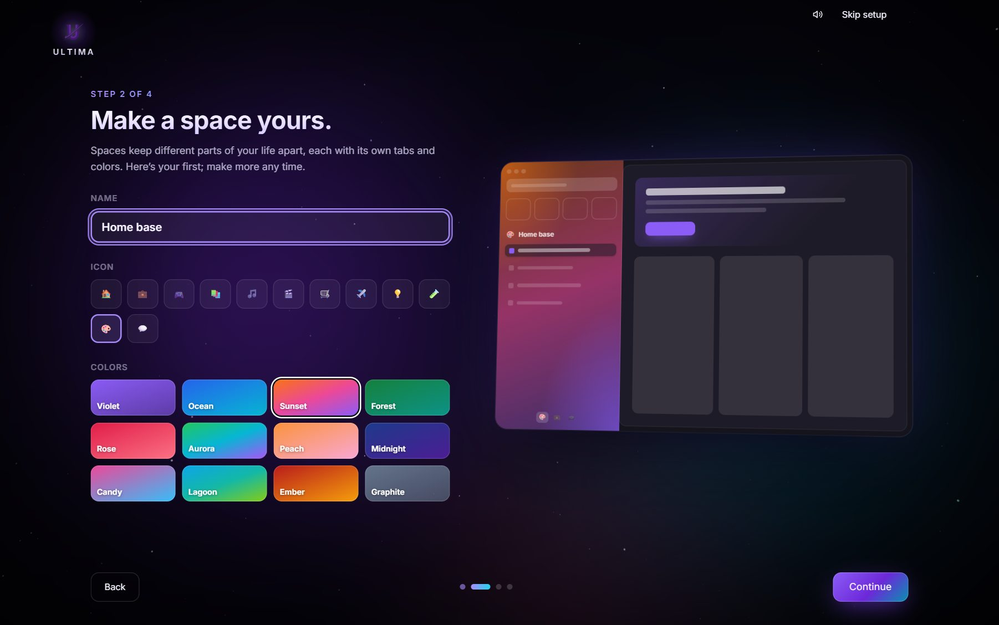
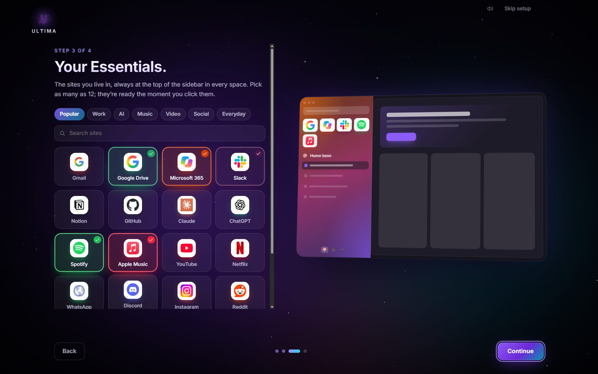

# Ultima Browser

**The browser that moves at your speed.**

Vertical tabs, orbits for every part of your life, a built-in ad blocker and a palette that finds anything,
all on the Chromium engine your favorite sites already work with.

### [⬇ Download Ultima](https://github.com/whatthebassett/UltimaBrowser/releases/latest)

Windows 10 and 11 &nbsp;·&nbsp; macOS on Apple Silicon &nbsp;·&nbsp; Free

 

 

## What's new in 0.6.0

Ultima 0.6.0 is all about the stuff you'd rather not think about. It keeps you away from phishing sites, it gets out of your way faster when you open it, and, if you want it to, it lets us know when something breaks so we can fix it. Already have Ultima? It updates itself the next time you close it, or right away from Settings → About → Restart to update.

### Dangerous site warnings

Phishing sites are the fake ones: a login page that looks exactly like your bank's, a "your package is delayed" text, a Microsoft sign-in that isn't Microsoft at all. They're built to grab your password or your card number, and they're getting scarily good at looking legit.

Ultima now keeps a list of hundreds of thousands of active phishing sites and checks every site you open against it. Land on one, and Ultima stops the page before it even loads and shows you a big red **Dangerous site ahead** warning instead.

- **Private by design.** The list lives on your computer and the check happens right there. Nothing about where you browse gets sent to us, or anyone else, to be looked up.
- **Always up to date.** The list comes from the open [Phishing.Database](https://github.com/mitchellkrogza/Phishing.Database) project and refreshes itself in the background, only downloading again when it has actually changed.
- **Downloads are covered too.** If a phishing site tries to hand you a file, Ultima stops the download and tells you why.
- **You're still in charge.** Hit **Back to safety** to get out of there, or **Continue anyway** if you know better. Ultima won't bug you about that site again until you restart it.
- **Want to see it in action?** Type `phishing-test.ultimabrowser.invalid` into the address bar. It's a made-up address that only exists to show you the warning, so it's completely safe to try.

It's on from the start, and you can switch it off in Settings → Privacy if you'd rather go without.

### Faster start

Ultima now opens about twice as fast. We dug into what happens in the second or so after you click the icon, and found a few things holding the whole show up:

- **The window shows up right away.** It no longer sits there waiting for extensions and protected-video support to finish loading. Those keep getting ready in the background while you're already looking at your tabs.
- **No flash of the wrong look.** The window waits until your colors and tabs are drawn before it appears, so it opens looking like *your* Ultima, not the default one.
- **The ad blocker is ready in a blink.** Instead of working through 150,000+ filter rules on every launch, Ultima keeps the finished blocker on disk and loads it back in a fraction of the time.
- **Extensions stopped slowing things down.** A couple of behind-the-scenes checks were reading every file of every extension, and running Windows' registry tool over and over, each time you opened Ultima. Not anymore.

In our testing, the window now appears in about half a second, and your first page finishes loading about a second sooner.

### Crash reports

Crashes are no fun, and they're a lot easier to fix when we actually know about them. Ultima can now send a report when it crashes or runs into an error, so problems get spotted and fixed sooner, even the ones we'd never run into ourselves.

- **Completely opt-in.** It's off until you turn it on in Settings → Privacy, and nothing is sent before that.
- **About Ultima, not about you.** Reports are about what went wrong inside Ultima. We don't attach your IP address or a list of the sites you visit, though a crash report can include bits of whatever Ultima had open at that moment.

### Mini player, sorted

The mini player got some love this time around:

- **It only opens when you ask.** No more player popping up just because a tab in the background started making noise. Send a video there yourself with the button on the video, its right-click menu, or a site's own picture-in-picture button.
- **Tall videos can be resized.** Shorts, Reels and other portrait videos now grow and shrink like any other video, and the player always stays fully on your screen.
- **Docked in the sidebar? You pick the size.** Drag the handle along the top of a docked video to choose how much room it takes, so your tabs stay in view. Ultima remembers the size you like.

### Also new

- **Fresh window buttons.** Minimize, maximize and close now have Ultima's own rounded icons, while still working exactly like Windows' own, snap layouts and all.
- **Fixed:** you can drag the window from anywhere in the row of buttons at the top of the sidebar, even between the buttons and on greyed-out ones.

[Every release](https://github.com/whatthebassett/UltimaBrowser/releases)

 

## Your tabs, standing tall

Tabs live down the side, where long titles fit and dozens of tabs stay readable. Prefer them across the top? Switch to **horizontal tabs** in a click. The sites you use every day sit at the top as **Essentials**, one click away in every space. **Pinned tabs** stay put, folders keep projects together, and Ultima can even **group tabs for you**: your Google Docs, Jira tickets or Slack channels gather in their own named folder on their own.

## An orbit for everything

Keep **Work**, **Personal** and **Play** apart, each with its own tabs, its own color gradient, and if you like, its own sign-ins, so your work and personal accounts never mix. Swipe between orbits with two fingers or a shortcut.

## Everything, one keystroke away

Press **Ctrl+K** and the **Control Palette** finds open tabs, history, Waypoints (your bookmarks) and every command in Ultima. Or type an address, or just search.

## Peek before you leap

**Glance** opens a link in a preview right over the page, with Alt+click, Shift+click or a long press. Read it, use it, then close it, keep it as a tab, or put it **side by side** in split view.

## Fewer ads, no one following you

Ultima blocks ads and trackers out of the box, including video ads and sponsored posts, using the same lists as uBlock Origin. It takes the tracking codes out of links you open and asks sites not to sell your data. One click on the shield turns it off for a site you want to support. And before you open a known phishing site, Ultima stops and warns you, checked right on your computer.

## Ready from the first minute

A short welcome sets Ultima up with you: light or dark, your colors, your first orbit, and **Essentials** picked from popular sites like Google Drive, Microsoft 365, Slack, Spotify, Apple Music, Netflix and dozens more. It brings over your bookmarks, history and open tabs from Chrome, Edge, Brave, Vivaldi or Firefox in one click, too.

## And a lot more

- **Movie night, sorted.** Netflix, Disney+, Prime Video and other streaming services play right in Ultima.
- **Chrome extensions.** Install them straight from the Chrome Web Store.
- **Read and translate.** Reader view strips an article down to its words, and one click translates a page into your language.
- **Screenshots** of part of a page, what's on screen, or the whole page, copied and saved in one go.
- **Private windows and tabs** that leave nothing behind when you close them.
- **Passwords** saved on your computer, encrypted with your Windows account or Mac Keychain.
- **Make it yours.** Accent colors, frosted-glass sidebar, your choice of font and tab size, and every keyboard shortcut is yours to change.
- **Accessibility** built in: page zoom, text size, contrast, color filters for color blindness, caret browsing and reduced motion.
- **Task manager** (Shift+Esc) to see what each tab uses and end the ones that misbehave.
- **Crash reports,** only if you want them, so problems get fixed sooner.
- **More than one window**, all sharing your orbits and Essentials, and everything comes back when you reopen Ultima.

 

## Install

**Windows 10 or 11**

1. Download **Ultima Browser Setup.exe** from the [latest release](https://github.com/whatthebassett/UltimaBrowser/releases/latest).
2. Open it and click **Install**. It installs just for you; no administrator rights needed.
3. If Windows shows *“Windows protected your PC”*, click **More info → Run anyway**. Ultima is new and not yet signed with a paid certificate.

**macOS (Apple Silicon)**

1. Download the **.dmg** from the [latest release](https://github.com/whatthebassett/UltimaBrowser/releases/latest) and drag Ultima to Applications.
2. The first time you open it, macOS asks you to allow it: go to **System Settings → Privacy & Security** and click **Open Anyway**.

**Updating:** Ultima updates itself. New versions download in the background and install when you close Ultima, or right away from **Settings → About → Restart to update**. Your tabs, Waypoints, passwords and settings stay right where they are.

## Roadmap

What's still to come, roughly in order.

**Safety**
- [x] Warnings for phishing sites and their downloads, checked on your computer.
- [ ] Warnings for malware sites and dangerous files.
- [ ] Signed installers, so Windows and macOS stop warning on first install.

**Everyday browsing**
- [x] Translate pages.
- [x] Reader view for articles.
- [x] Screenshots of a page or part of one.
- [x] Bring over open tabs from Chrome and Edge.

**Passwords and forms**
- [ ] Fill logins inside embedded sign-in forms.
- [ ] Save and fill addresses and payment cards.

**Extensions**
- [ ] Userscript managers like Tampermonkey.
- [ ] Extensions that act on the current tab when you click them (activeTab), like Google Translate.
- [ ] Extension shortcuts that work when Ultima isn't in front.

**Your stuff everywhere**
- [ ] Sync Waypoints, passwords, orbits and settings across your devices, end-to-end encrypted.

**Under the hood**
- [x] Opt-in crash reports.
- [x] Automated tests for tabs, sessions, the ad blocker and import.

## Questions

**Is Ultima free?** Yes.

**Where is my data kept?** On your computer, in your user folder. Ultima has no account and no cloud; your history, Waypoints and passwords never leave your PC.

**Will my sites work?** Ultima runs on Chromium, the engine behind Chrome and Edge, so sites work as they do there.

**Why is Netflix limited to 720p?** Like Chrome, Ultima uses the software version of Widevine, which Netflix caps at 720p on desktop browsers.

**How do I uninstall it?** Windows: Settings → Apps → Ultima Browser → Uninstall. Your data is kept unless you choose to delete it.

 

**[Download Ultima](https://github.com/whatthebassett/UltimaBrowser/releases/latest)** &nbsp;·&nbsp; [What's new](https://github.com/whatthebassett/UltimaBrowser/releases) &nbsp;·&nbsp; [For developers](DEVELOPING.md)

